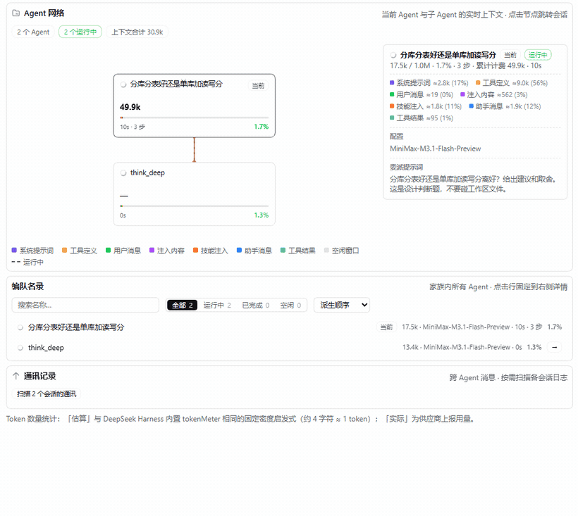

# dsh-delegation-policy

给 DeepSeek Harness 用的插件：**让 AI 该查的时候去查、该想清楚的时候想清楚——而且它跑不掉。**



---

## 你在跟一个记性不太好的 AI 干活

它有两个老毛病。

**一、该查的不查。** 你问它某个库是哪个版本出的、某个接口怎么用，它凭记忆答，答错了还特别自信。

**二、该想的不想。** 你问它"用队列好还是读写分离好"、"重试该退避还是固定间隔"，它想三秒钟就给你答案。

你当然可以在提示词里写"请先查资料再回答"。但提示词是**嘱咐**，不是**规矩**——模型一忙起来就忘。

这个插件把嘱咐变成**拦得住的规矩**。AI 想偷懒的时候，插件当场把它拽回来。

---

## 插件做了三件事

### 一、不许自己上网

AI 想查资料只有一条路：`search_web`。它自己直接联网会被**拒绝**，然后被告知改用这个工具。

这样查到的网页不会塞进你们俩的对话里。对话记录保持干净，AI 拿到的是整理好的答案和出处。

### 二、每次联网都有额度

出去查资料的助手能用几次搜索，是有数的。用完了就被拦住，让它用手上已有的材料作答。

### 三、判断题不许糊弄过去

插件给 AI 一个叫 `classify_question` 的工具：**它必须先说清楚，这题是要"给个推荐 / 比一比 / 做取舍"，还是"查个事实"。**

然后插件盯着它。**当它这一轮话说完了、准备收尾的时候**，插件检查：

- 它压根没分类 → **把它拽回这一轮**，要求先分类，这一轮不许结束
- 它说了"这是判断题"，但还没找人帮忙想 → 同样拽回来，要求先走 `think_deep`
- 连着拽两次还不听 → 放行。规矩是规矩，不是陷阱——AI 总得有办法回答

> 为什么盯"这一轮说完"，而不是"这一轮结束"？
> 一轮结束只有两种情况：某个工具说"到此为止"，或者 AI 自己答完了。只有第二种才值得拽。

**这条规矩只管主 AI。** 出去干活的助手有**完全权限**，想用什么工具用什么——它们不会被拽回，也不必分类。

---

## 你问一句之后，实际发生了什么

假设你问：

> 分库分表好还是单库加读写分离好？给个建议。

这是个判断题。AI 照规矩办：

1. **它先说明**："这是判断题，外部资料查不到，答案取决于你的数据量、访问模式和团队能力，所以我交给 `think_deep` 去想。"
2. **它叫来 `think_deep`** —— 一个继承了整段对话的助手（它知道你之前说过什么），专门想这个问题
3. **有人旁听它写东西** —— 插件在旁听，记下它写的推理和回答
4. **另一个助手从这份记录里挑关键词** —— 跑在**你指定的模型**上，只干这一件事：把"哪几句话需要拿外部资料核对"变成几个检索词
5. **再一个助手去搜** —— 它什么都不记得，只管查，查完把知识和出处带回来
6. **`think_deep` 再想一轮** —— 这一轮它手上有知识了，该改主意的地方就是改主意的地方
7. **结论回到你面前** —— 结论、关键点、假设、风险
8. **主 AI 只负责把结论展示出来** —— 这一轮已经交给 `think_deep` 了，它不再自己搜、自己查、自己改文件；想再动手会被当场拒绝

**搜回来的那些资料不会直接给你。** 它们只用来改变 AI 的想法，给你的始终是**想完之后的那份结论**。

**这一轮就是它的。** 判断题整轮交给 `think_deep`：推理、检索、答案都在里面完成，主 AI 拿到什么就展示什么。想问题的助手也只负责回答——它不会被允许把答案写成一份文档丢进你的工作区。

---

## 这条流水线是看得见的


Harness 自带的「编队」页，把每一个出去干活的助手画成一张卡片，实时显示它用了多少上下文、跑了多久、花了多少钱。

上面那张图就是上面那段动图的最后一帧，同一次真实运行。最上面是主 AI；第二行三个并行——**`think_deep`（想问题的）**、**挑关键词的**、**查资料的**；第三行是查资料那一步派出去的**搜索助手**。**第二轮推理发生在 `think_deep` 那张卡里**（同一个助手想两遍），所以不会再长出一张卡。

看一眼下面的名录就知道谁是谁：

| 名录里的名字 | 它是谁 | 用哪个模型 |
|---|---|---|
| `think_deep` | 两轮推理（同一个助手先想、拿到资料后再想） | 跟着主 AI |
| `Below is the reasoning and…` | 挑关键词的 | **你指定的那个**（默认跟主 AI 一样） |
| `Look up the following terms…` | 查资料的 | 跟着主 AI |
| `Search the web for: …` | 搜索助手 | 跟着主 AI |

> **以前还有一个"抬杠助手"**，专门去挑结论的毛病。它已经被整个删掉了：它只看到结论，还得自己再挖一遍该查什么，而且经常交不出卷；上面第 4 步读的是孩子的**完整推理**，挖得出来。
> 结论由**同一个孩子**拿着资料重想一遍定稿，中间不再有第三个声音。

---

## 开了插件 vs 没开插件，实测

同一个模型（MiniMax-M3.1-Flash）、同一个沙盒、同一句提示词，各跑两次。**下面的 token 都把子代理的用量算进去了** —— 只算主会话会把插件那侧的账算少一半以上。

### 一、判断题：缓存层选 Redis 8 还是 Valkey

> 我们是自研 SaaS 产品，准备把缓存层定下来：Redis 8 还是 Valkey？法务关心的是能不能闭源分发、要不要开源自己的改动。给出建议和取舍。这是选型判断题，不要碰工作区文件。

这题正好是 `think_deep` 的场景：法务要的是"我到底会不会被迫开源"，而它取决于**最近两年改过两次的许可证事实**加上**你们的交付形态**，不是查一个版本号能答的。

| | 没开插件 | 开了插件 |
|---|---|---|
| **总 token（含子代理）** | **2,554,229** | **329,661** |
| 其中主会话本身 | 375,890 | 96,279 |
| 未缓存输入 | 188,053 | 114,348 |
| 缓存读取 | 2,293,760 | 157,058 |
| 输出 | 72,416 | 58,255 |
| **耗时** | 10 分 51 秒 | **7 分 39 秒** |
| 主会话步数 | 9 步 | **3 步** |
| 子代理 | 1 个通用子代理，48 步 | 3 个（推理 / 挑关键词 / 查资料） |
| **结论** | 选 Valkey | 选 Valkey |
| 关键许可证事实有出处 | 有 | 有 |

**这一轮：token 少 7.7 倍，时间少 1.4 倍，结论一样。** 差别不在结论，在工作放在了哪：

- **没开插件**：主 AI 自己 `web_search`、`web_fetch` 抓 redis.io/legal/licenses，页面全进自己的上下文；它还起了一个通用子代理 `reviewer`，那个子代理跑了 **48 步、烧掉 218 万 token** —— 没有预算上限，也没有人告诉它"读完就交答案"，它一直在重读自己越来越长的历史。
- **开了插件**：主 AI 只做三步 —— 分类、把题交给 `think_deep`、把返回的结论写出来。检索发生在 3 个一次性子代理里，各自有预算、读完就扔。而且这一轮的子代理**没有往工作区写任何文件**，只把答案交回来。

### 二、事实核查题：GTID_UNION()

> MySQL 8.4 里 GTID_UNION() 这个内置函数，是什么版本引入的？给出结论、关键点、假设、风险。这是事实核查题。

这题本身是个坑：**MySQL 从来没有这个内置函数**。8.4 手册里出现的 `GTID_UNION()`，是手册教你自己用 `CREATE FUNCTION` 建的示例。照着"哪个版本引入"去查，很容易编出一个版本号。

| | 没开插件 | 开了插件 |
|---|---|---|
| **总 token（含子代理）** | **4,841,050** | **1,510,520** |
| 其中主会话本身 | 3,748,747 | 277,754 |
| 未缓存输入 | 248,408 | 238,550 |
| 缓存读取 | 4,528,208 | 1,162,053 |
| 输出 | 64,434 | 109,917 |
| 缓存命中率 | 93.5% | 76.9% |
| **耗时** | **10 分 38 秒** | 18 分 00 秒 |
| 主会话步数 / 子代理 | 44 步 + 1 个子代理 | 10 步 + 11 个子代理 |
| **结论** | 正确（"这个函数不存在"） | 正确（同一个结论） |

**这一轮：token 少 3.2 倍，但慢了约 7 分钟。**

### 两轮下来，钱到底花在哪儿

看"未缓存输入"那一行：两轮的**新输入**差不多（24.8 万 vs 23.9 万，18.8 万 vs 11.4 万）。真正拉开差距的是**缓存读取** —— 每多一步，模型都要重读一遍之前积累的全部历史。没开插件时，试错、抓页面、绕镜像全堆在同一个上下文里，历史越滚越大，后面每一步都在为前面买单，这是复利的。

> 事实核查那一轮，两次都撞上 dev.mysql.com 对抓取返回 403、都得绕镜像 —— 这正是差距的来源。网络顺畅时差距会小，但"试错发生在一口气就扔的子代理里、不回流主上下文"这个机制不变。

**代价也是真的**：插件不是免费的。事实核查那一轮它慢了约 7 分钟（11 个子代理一个个起，就是 11 段等待）；判断题那一轮它反而更快，因为对方那个 48 步的通用子代理在空转。**它买的不是"更快"，是"试错关在一次性子代理里"。**

**所以它适合**：需要核实外部事实、需要判断取舍、答错代价高、上下文预算有限的长任务。**不适合**：一句话就能答的小问题。

## 装上

```sh
# 跟着最新版走
dsh plugin add github:zyn19940107/dsh-delegation-policy

# 或者钉住 1.0 这一版
dsh plugin add github:zyn19940107/dsh-delegation-policy#v1.0.0
```

或者从本地装：

```sh
git clone https://github.com/zyn19940107/dsh-delegation-policy
cd dsh-delegation-policy && pnpm install
dsh plugin add /path/to/dsh-delegation-policy
```

## 改设置

**在页面上改（推荐）**：Plugins → Delegation policy

- **提取器用哪个模型** —— 第 4 步那个专门挑关键词的助手，跑在哪个模型上
- **最多挑几个关键词**
- **要不要强制判断题走委派** —— 关掉就没有第三条规矩

**在配置文件里改**（`cordis.patch.yml`）：

```yaml
- insert:
    - id: delegation-policy
      name: '@zyn19940107/dsh-delegation-policy'
      config:
        keywordMaxCount: 3                 # 最多挑几个关键词
        keywordSearchCalls: 3              # 搜索助手的次数额度
        judgementEnabled: true             # 要不要强制判断题走委派
        judgementMaxPullbacks: 2           # 最多拽回几次
        watchMaxChars: 8000                # 旁听能记下多少字
```

**挑关键词的助手默认跟主 AI 用同一个模型**。想单独指定，再加 `keywordModel` + `keywordModelProvider` 两行。

页面上改的和这里改的是**同一份配置**：页面改了这边就变，这边改了刷新页面就看见。

## 自己改代码

```sh
pnpm build        # 打包
pnpm typecheck    # 类型检查
pnpm specs        # 跑测试
```

## License

MIT
