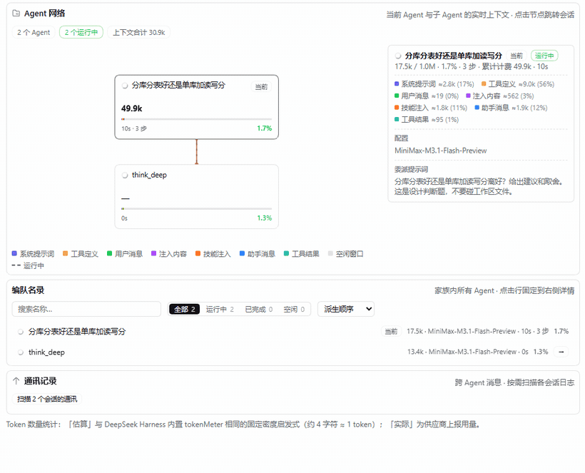
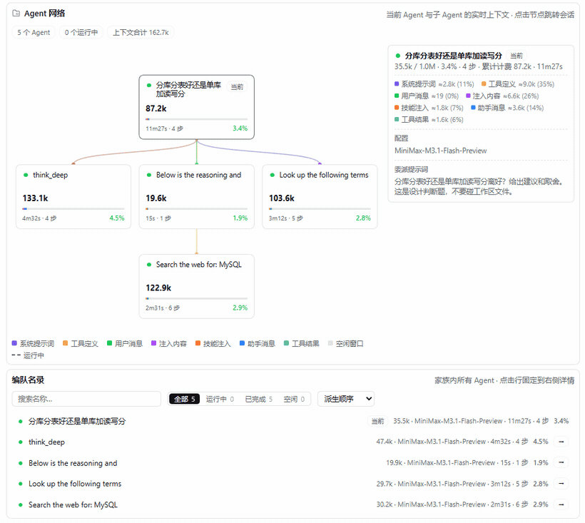

# dsh-delegation-policy

给 DeepSeek Harness 用的插件：**让 AI 该查的时候去查、该想清楚的时候想清楚——而且它跑不掉。**



---

## 你在跟一个记性不太好的 AI 干活

它有两个老毛病。

**一、该查的不查。** 你问它某个库是哪个版本出的、某个接口怎么用，它凭记忆答，答错了还特别自信。

**二、该想的不想。** 你问它"用队列好还是读写分离好"、"重试该退避还是固定间隔"，它想三秒钟就给你答案。

你当然可以在提示词里写"请先查资料再回答"。但提示词是**嘱咐**，不是**规矩**——模型一忙起来就忘。

这个插件把嘱咐变成**拦得住的规矩**。AI 想偷懒的时候，插件当场把它拽回来。

---

## 插件做了三件事

### 一、不许自己上网

AI 想查资料只有一条路：`search_web`。它自己直接联网会被**拒绝**，然后被告知改用这个工具。

这样查到的网页不会塞进你们俩的对话里。对话记录保持干净，AI 拿到的是整理好的答案和出处。

### 二、每次联网都有额度

出去查资料的助手能用几次搜索，是有数的。用完了就被拦住，让它用手上已有的材料作答。

### 三、判断题不许糊弄过去

插件给 AI 一个叫 `classify_question` 的工具：**它必须先说清楚，这题是要"给个推荐 / 比一比 / 做取舍"，还是"查个事实"。**

然后插件盯着它。**当它这一轮话说完了、准备收尾的时候**，插件检查：

- 它压根没分类 → **把它拽回这一轮**，要求先分类，这一轮不许结束
- 它说了"这是判断题"，但还没找人帮忙想 → 同样拽回来，要求先走 `think_deep`
- 连着拽两次还不听 → 放行。规矩是规矩，不是陷阱——AI 总得有办法回答

> 为什么盯"这一轮说完"，而不是"这一轮结束"？
> 一轮结束只有两种情况：某个工具说"到此为止"，或者 AI 自己答完了。只有第二种才值得拽。

**这条规矩只管主 AI。** 出去干活的助手有**完全权限**，想用什么工具用什么——它们不会被拽回，也不必分类。

---

## 你问一句之后，实际发生了什么

假设你问：

> 分库分表好还是单库加读写分离好？给个建议。

这是个判断题。AI 照规矩办：

1. **它先说明**："这是判断题，外部资料查不到，答案取决于你的数据量、访问模式和团队能力，所以我交给 `think_deep` 去想。"
2. **它叫来 `think_deep`** —— 一个继承了整段对话的助手（它知道你之前说过什么），专门想这个问题
3. **有人旁听它写东西** —— 插件在旁听，记下它写的推理和回答
4. **另一个助手从这份记录里挑关键词** —— 跑在**你指定的模型**上，只干这一件事：把"哪几句话需要拿外部资料核对"变成几个检索词
5. **再一个助手去搜** —— 它什么都不记得，只管查，查完把知识和出处带回来
6. **`think_deep` 再想一轮** —— 这一轮它手上有知识了，该改主意的地方就是改主意的地方
7. **结论回到你面前** —— 结论、关键点、假设、风险

**搜回来的那些资料不会直接给你。** 它们只用来改变 AI 的想法，给你的始终是**想完之后的那份结论**。

---

## 这条流水线是看得见的



Harness 自带的「编队」页，把每一个出去干活的助手画成一张卡片，实时显示它用了多少上下文、跑了多久、花了多少钱。

上面那张图是一次真实运行。最上面是主 AI，第二行三个并行——**第一轮推理**、**挑关键词的**、**查资料的**——第三行是几个搜索助手，然后是**第二轮推理**。

看一眼下面的名录就知道谁是谁：

| 名录里的名字 | 它是谁 | 用哪个模型 |
|---|---|---|
| `Think this through thoroughly: 回答用…` | 第一轮推理 | 跟着主 AI |
| `Below is the reasoning and…` | 挑关键词的 | **你指定的那个** |
| `Look up the following terms…` | 查资料的 | 跟着主 AI |
| `Search the web for: …` | 搜索助手 | 跟着主 AI |
| `You reached the conclusion below…` | 第二轮推理 | 跟着主 AI |

> **曾经还有一个"抬杠助手"**，专门去挑结论的毛病，挑出来就再查一次、再改一轮。
> 现在**默认没有它了**——上面第 4 步已经在干同样的活，而且干得更好：它读的是孩子的**完整推理**，能挖出该搜什么；抬杠助手只看到结论，还得自己再挖一遍，而且经常交不出卷。
> 唯一它能抓到而别的抓不到的，是"引用了来源，但引的不是这一条"这类毛病。想把它加回来，把配置里的 `verifyRounds` 改成 `1` 或 `2` 就行。

---

## 开了插件 vs 没开插件，实测

同一个问题、同一个模型（MiniMax-M3.1-Flash）、同一个沙盒，跑两次：

> 分库分表好还是单库加读写分离好？给出建议和取舍。这是设计判断题，不要碰工作区文件。

| | 没开插件 | 开了插件 |
|---|---|---|
| **耗时** | 56 秒 | **5 分 50 秒** |
| **总 token** | 34,156 | **73,463** |
| 未缓存输入 | 14,482 | 22,210 |
| 缓存读取 | 14,137 | 46,538 |
| 输出 | 5,537 | 4,715 |
| 缓存命中率 | 49.4% | 67.7% |
| **结论** | 正确（先读写分离，后分片） | 正确（同一个结论） |
| 关键数字有出处吗 | **没有**（凭记忆给的） | **有**（每个论断标了来源） |

**说实话：这一题上，插件让答案贵了 2.1 倍、慢了 6 倍，而结论是同一个。**

那它买到了什么？买到的是**可核查**。没开插件那一次，模型给的“单表 2000 万行”“主库 CPU 60-70%”这类阈值全是凭记忆写的，一个来源都没有 —— 它可能对，也可能不对，你无法判断。开了插件那一次，同样的数字带着出处，错的能被当场指出来。

代价也是真的：多出来的 39,307 token 几乎全花在**缓存读取**（46,538 vs 14,137）—— 思考子代理继承整段对话，每一轮都要重新读一遍。这是 fork 的固有成本，不是插件写错了。

**所以它适合这种场景**：答案是判断题、错了代价高、你需要知道凭什么。**不适合**：你只是要个大概方向，或者问题本身就很小 —— 那种情况把 `judgementEnabled` 关掉就行。

## 装上

```sh
dsh plugin add github:zyn19940107/dsh-delegation-policy
```

或者从本地装：

```sh
git clone https://github.com/zyn19940107/dsh-delegation-policy
cd dsh-delegation-policy && pnpm install
dsh plugin add /path/to/dsh-delegation-policy
```

## 改设置

**在页面上改（推荐）**：Plugins → Delegation policy

- **提取器用哪个模型** —— 第 4 步那个专门挑关键词的助手，跑在哪个模型上
- **最多挑几个关键词**
- **要不要强制判断题走委派** —— 关掉就没有第三条规矩

**在配置文件里改**（`cordis.patch.yml`）：

```yaml
- insert:
    - id: delegation-policy
      name: '@zyn19940107/dsh-delegation-policy'
      config:
        keywordModel: deepseek-v4-pro       # 挑关键词的助手用哪个模型
        keywordModelProvider: deepseek-official
        keywordMaxCount: 3                 # 最多挑几个关键词
        keywordSearchCalls: 3              # 搜索助手的次数额度
        judgementEnabled: true             # 要不要强制判断题走委派
        judgementMaxPullbacks: 2           # 最多拽回几次
        watchMaxChars: 8000                # 旁听能记下多少字
        verifyRounds: 0                    # 抬杠助手跑几轮（0 = 不跑）
```

页面上改的和这里改的是**同一份配置**：页面改了这边就变，这边改了刷新页面就看见。

## 自己改代码

```sh
pnpm build        # 打包
pnpm typecheck    # 类型检查
pnpm specs        # 跑测试
```

## License

MIT
